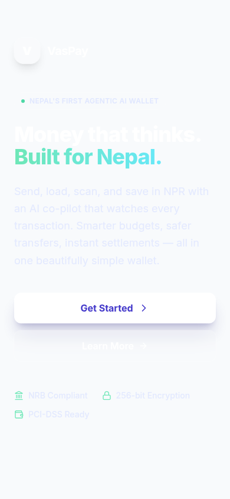
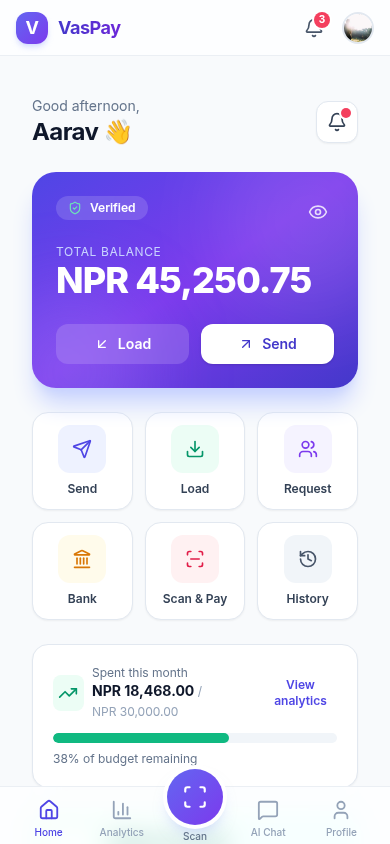
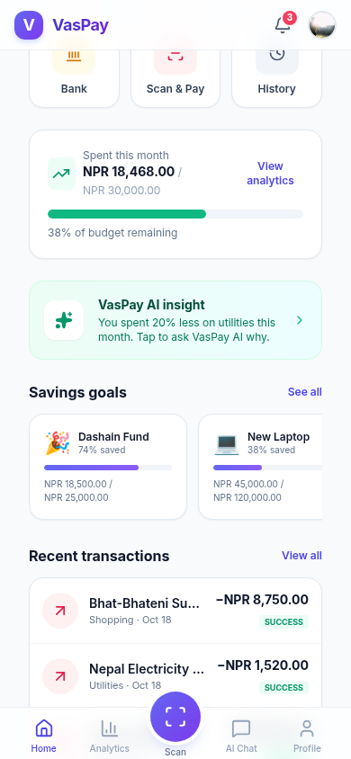
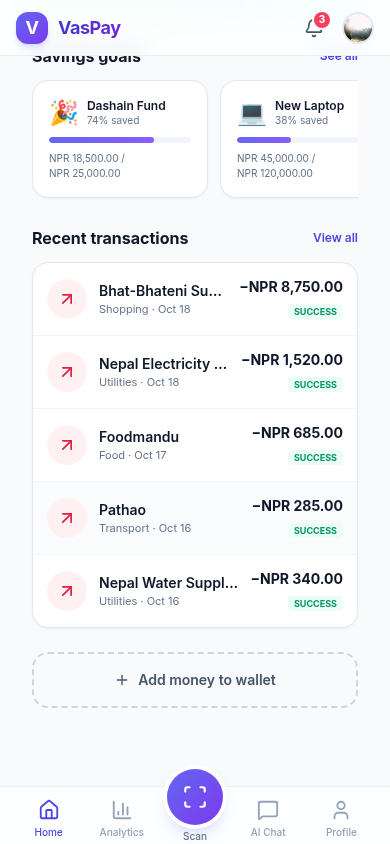
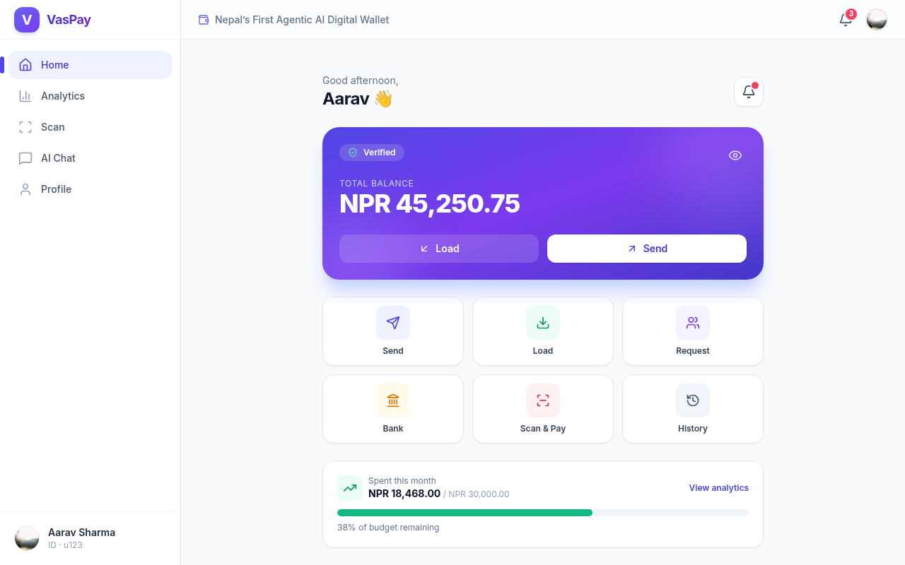

# VasPay — Nepal's First Agentic AI Digital Wallet

[](https://react.dev)
[](https://www.typescriptlang.org)
[](https://vitejs.dev)
[](https://tailwindcss.com)
[](https://ai.google.dev)
[](./LICENSE)

> A Vite + React 19 + TypeScript wallet reimagined for the Nepalese market — send money, scan-to-pay, bank transfers, cards, and savings goals, all wrapped around an agentic AI assistant that detects fraud, analyzes spending, and coaches your budget.

---

## Abstract

VasPay is a research-grade reference design for what a next-generation Nepalese
digital wallet could look like if it were built **agentic-AI-first** rather than
tacking an "AI insights" widget onto a conventional payments app. Every primary
flow — sending money, scanning a QR, reviewing transactions, opening the
analytics dashboard — is wired into a Gemini-powered financial assistant that
can surface proactive advice, run fraud-risk checks before a transfer is
confirmed, summarize spending by category, propose monthly budgets calibrated to
Nepalese cost-of-living realities (Dashain expenses, NEA bills, Pathao rides,
Worldlink internet), and flag anomalies in transaction history.

The application ships as a single Vite + React 19 + TypeScript project that
runs entirely in the browser. Styling uses Tailwind via CDN with a small custom
design-system extension (Inter typeface, indigo/violet brand palette, semantic
emerald/rose/amber colors, refined card + glow shadows). Data visualization
uses Recharts. The AI layer talks to `@google/genai` and degrades gracefully
when no `GEMINI_API_KEY` is configured — see [Demo mode](#-demo-mode).

VasPay is **not** a real payment instrument. No money moves, no real bank APIs
are called, no PII is collected. It is a UI/UX + AI-capability demo intended to
showcase what an agentic AI wallet experience could feel like. See
[Honesty](#-honesty).

---

## Table of Contents

1. [Abstract](#abstract)
2. [Features](#-features)
3. [Architecture](#-architecture)
4. [Project Structure](#-project-structure)
5. [Quick Start](#-quick-start)
6. [Pages](#-pages)
7. [The AI Assistant](#-the-ai-assistant)
8. [Demo Mode](#-demo-mode)
9. [Honesty](#-honesty)
10. [Tech Stack](#-tech-stack)
11. [License](#-license)

---

## ✨ Features

### Screenshots

The screenshots below are **proof that the deployed app actually runs** — they were captured by `agent-browser` against a live `vite preview` server.

| Landing hero | Dashboard | Quick actions | Transactions | Desktop |
|---------------|-----------|---------------|--------------|---------|
|  |  |  |  |  |

**Landing hero** — "Money that thinks. Built for Nepal." with a Get Started CTA + NRB Compliant / 256-bit Encryption / PCI-DSS Ready badges.
**Dashboard** — Total balance in NPR, Load/Send actions, quick-action grid (Send/Load/Scan & Pay), monthly spend vs budget summary, bottom nav with AI Chat.
**Quick actions** — Send Money, Load Money, Scan & Pay, Savings goals, Bank Transfer, Cards.
**Transactions** — Recent transaction list with merchant icons + amounts.
**Desktop** — Responsive at 1280px width.

### Wallet

- **Send Money** — Recipient + amount + remarks form with an in-flow AI
  fraud-risk check (`detectFraudRisk`) that runs *before* the user confirms the
  transfer. High-risk transactions surface a red warning card; low-risk
  transactions proceed to a success state.
- **Request Money** — Static QR code for the user's VasPay ID plus a manual
  "request from a friend" form (mobile + amount).
- **Load Money** — Loader flow mirroring the Nepalese ecosystem: Mobile Banking,
  eBanking, Connect IPS, and Debit/Credit Card.
- **Bank Transfer** — Searchable list of popular Nepalese banks (Nabil, Global
  IME, NIC Asia, Siddhartha, Himalayan, Everest).
- **Scan &amp; Pay** — Full-screen camera-viewport simulation with a scanning
  animation, a simulated QR-detection pop-in, an AI "merchant is verified" hint,
  and a confirm-payment flow.
- **Cards** — Manage linked debit/credit cards.
- **Savings** — Track savings goals and progress.
- **Transactions** — Searchable, filterable transaction history with
  receive/payment direction arrows and status badges.

### AI

- **Financial Assistant Chat** — Conversational interface powered by Google
  Gemini with a system instruction that scopes the model to VasPay-context
  queries (NPR currency, Nepalese merchants and billers, demo-mode disclaimer
  for actionable requests). Suggestion chips seed the conversation.
- **Fraud-Risk Detection** — Pre-transfer risk scoring that returns a
  `{ risk: 'low' | 'medium' | 'high', reason: string }` verdict displayed in the
  Send Money flow.
- **Spending Analysis** — Category breakdowns and monthly trend charts rendered
  with Recharts (pie + bar). The assistant can summarize "How much did I spend
  on food?" by reading the transaction context attached to each prompt.
- **Budget Suggestions** — Calibrated to Nepalese realities (Dashain expenses,
  local utility costs) and surfaced as actionable advice.
- **Anomaly Detection** — Flag unusual transactions in the user's history.

### UX

- A **mobile-first wallet UI** with a sticky frosted-glass header, a raised
  primary "Scan" action in the bottom navigation, and a left rail on desktop
  viewports.
- **14 distinct pages** composed via a single state-based router in `App.tsx`.
- A refined **fintech aesthetic** — Inter typeface, gradient brand lockup,
  soft card shadows, and accessible focus rings throughout.
- **Safe-area aware** (iPhone home indicator + notch) via `pb-safe` / `pt-safe`.
- **Reduced-motion friendly** — respects `prefers-reduced-motion`.
- **Accessible** — semantic landmarks, `aria-current` on active nav items,
  `aria-label`s on icon-only buttons, keyboard focus rings.

---

## 🏗 Architecture

VasPay is intentionally **lightweight** — no backend, no router library, no
state container. Everything lives in the browser.

```
┌───────────────────────────────────────────────────────────────────────┐
│  index.html  ──→  Tailwind CDN  +  inline tailwind.config            │
│                  (Inter, primary/accent/success/danger/warning,       │
│                   card/soft/glow shadows, 2xl/3xl radii)              │
│  index.css   ──→  .glass, .card-shadow, .no-scrollbar, .thin-        │
│                   scrollbar, .pb-safe/.pt-safe, .animate-fade-in,   │
│                   focus-visible ring, prefers-reduced-motion          │
└───────────────────────────────────────────────────────────────────────┘
                                  │
                                  ▼
┌───────────────────────────────────────────────────────────────────────┐
│  index.tsx (entry) → ReactDOM.createRoot → <App />                    │
│                                                                        │
│  App.tsx  ─ state-based router (15 ViewStates, 14 page components)     │
│     │                                                                  │
│     ├──→  <Layout activeView onNavigate>   (header + left rail +       │
│     │    bottom nav)  — wraps all views except Landing + ScanPay       │
│     │                                                                  │
│     └──→  pages/*  (each default-exported)                              │
│              │                                                          │
│              └──→  services/geminiService.ts                            │
│                       │  (getFinancialAdvice, detectFraudRisk,          │
│                       │   analyzeSpending, suggestBudget,               │
│                       │   detectAnomaly — see AI assistant section)      │
│                       │                                                │
│                       └──→  @google/genai  (esm.sh)  ──→  Gemini API    │
│                            (or no-key demo fallback)                    │
└───────────────────────────────────────────────────────────────────────┘
```

**Routing model.** There is no URL router. The currently active view lives in
`useState` inside `App.tsx`; onboarding state is persisted to
`localStorage` under the `vaspay_visited` key. Returning users land directly
on the dashboard. The router switches over all 15 `ViewState` values, of which
`settings` aliases `Profile` — giving 14 distinct page components. Two views
(`landing`, `scan`) are intentionally full-screen and bypass the `Layout`
shell.

**Styling model.** Tailwind is loaded via the CDN script in `index.html` and
extended with an inline `tailwind.config` block. This keeps the build
dependency-free (no `tailwindcss` PostCSS plugin, no `purge` step) at the cost
of shipping Tailwind's runtime — a deliberate trade-off for a demo of this
size. A small `index.css` file provides custom utilities (`.glass`,
`.card-shadow`, `.no-scrollbar`, `.thin-scrollbar`, `.pb-safe`, `.pt-safe`,
`.animate-fade-in`, `.animate-pulse-ring`) plus a base layer (Inter typeface,
focus-visible ring, `prefers-reduced-motion`).

**AI model.** `services/geminiService.ts` instantiates a single
`GoogleGenAI` client configured from `process.env.API_KEY` (Vite's `define`
block maps `GEMINI_API_KEY` → `process.env.API_KEY` so the existing service
file keeps working). Each public function (`getFinancialAdvice`,
`detectFraudRisk`, plus the planned `analyzeSpending`, `suggestBudget`,
`detectAnomaly`) wraps a single `generateContent` call with a system
instruction that scopes the model to Nepalese wallet context and returns
graceful fallback strings if the API is unreachable.

---

## 📁 Project Structure

```
vaspay/
├── index.html                  # HTML shell: importmap, Tailwind CDN + config, Inter, index.css
├── index.css                   # Custom utilities + base layer (glass, card-shadow, pb-safe, …)
├── index.tsx                   # Entry point — ReactDOM.createRoot(<App />)
├── App.tsx                     # Root component + state-based router (15 ViewStates)
├── types.ts                    # Transaction, User, ChatMessage, Contact, ViewState
├── constants.ts                # MOCK_USER, MOCK_CONTACTS, MOCK_TRANSACTIONS, QUICK_ACTIONS
├── metadata.json               # App metadata + frame permissions (camera)
├── vite.config.ts              # Vite config (port 3000, GEMINI_API_KEY → process.env.API_KEY)
├── tsconfig.json               # TypeScript config
├── package.json                # Scripts (dev/build/preview) + dependencies
├── LICENSE                     # MIT
├── README.md                   # ← you are here
│
├── components/
│   └── ui/
│       └── Layout.tsx          # Header + desktop left rail + mobile bottom nav
│
├── services/
│   └── geminiService.ts        # @google/genai client + AI functions
│
└── pages/
    ├── Landing.tsx             # Onboarding screen with feature carousel
    ├── Dashboard.tsx           # Balance card, quick actions, AI insight teaser, recent txs
    ├── Analytics.tsx           # Spending pie + monthly trend bar + AI observation
    ├── AIChat.tsx              # Conversational AI assistant (Gemini)
    ├── ScanPay.tsx             # Full-screen QR-scanner simulation
    ├── SendMoney.tsx           # Recipient + amount + remarks + AI fraud-risk check
    ├── LoadMoney.tsx           # Load funds flow (mobile banking / eBanking / IPS / card)
    ├── RequestMoney.tsx        # Static QR + request-from-friend form
    ├── BankTransfer.tsx        # Searchable Nepalese-bank list
    ├── TransactionHistory.tsx  # Searchable, filterable transaction list
    ├── Profile.tsx             # User profile + settings entry
    ├── Cards.tsx               # Linked cards
    ├── Savings.tsx             # Savings goals + progress
    └── Notifications.tsx       # Notifications inbox
```

---

## 🚀 Quick Start

**Prerequisites**

- [Node.js](https://nodejs.org) 18+ (Vite 6 requires Node 18 or newer).
- (Optional) A Google Gemini API key from
  [Google AI Studio](https://aistudio.google.com/app/apikey). Without one, the
  app runs in [Demo mode](#-demo-mode).

**1. Install dependencies**

```bash
npm install
```

**2. (Optional) Set your Gemini API key**

Create a `.env.local` file at the project root:

```bash
# .env.local
GEMINI_API_KEY=your_api_key_here
```

Vite's `define` block (see `vite.config.ts`) maps this to
`process.env.API_KEY` / `process.env.GEMINI_API_KEY` so the existing
`geminiService.ts` keeps working unchanged.

> Without a key, the AI assistant still responds — see
> [Demo mode](#-demo-mode).

**3. Run the dev server**

```bash
npm run dev
```

The app starts on http://localhost:3000.

**4. Build for production**

```bash
npm run build      # outputs dist/
npm run preview    # serves the production build locally
```

---

## 📄 Pages

VasPay ships 14 distinct page components, composed via the 15-value
`ViewState` union (`settings` aliases `profile`). The router lives in
`App.tsx` and switches over the full union; the two full-screen views
(`landing`, `scan`) bypass the `Layout` shell entirely.

| #  | View              | Page Component      | Purpose                                                                                       | Layout?     |
|----|-------------------|---------------------|-----------------------------------------------------------------------------------------------|-------------|
| 1  | `landing`         | `Landing`           | Onboarding hero with three feature cards (AI Assistant, Fraud Protection, Seamless Payments)  | Full-screen |
| 2  | `dashboard`       | `Dashboard`         | Balance card, quick actions, AI insight teaser, recent transactions, quick-send contacts     | Shell       |
| 3  | `analytics`       | `Analytics`        | Total-spent hero, spending-by-category pie, monthly trend bar, AI observation                 | Shell       |
| 4  | `chat`            | `AIChat`           | Conversational assistant (Gemini) with suggestion chips and streaming "Thinking..." state     | Shell       |
| 5  | `scan`            | `ScanPay`           | Full-screen QR-scanner simulation + simulated merchant pop-in + AI verification hint         | Full-screen |
| 6  | `send_money`      | `SendMoney`         | Recipient + amount + remarks form with pre-confirm AI fraud-risk check                       | Shell       |
| 7  | `load_money`      | `LoadMoney`         | Loader flow: Mobile Banking, eBanking, Connect IPS, Debit/Credit Card                         | Shell       |
| 8  | `request_money`  | `RequestMoney`      | Static QR for the user's VasPay ID + request-from-friend form                                 | Shell       |
| 9  | `bank_transfer`   | `BankTransfer`      | Searchable list of popular Nepalese banks                                                     | Shell       |
| 10 | `transactions`    | `TransactionHistory` | Searchable, filterable transaction list with direction arrows + status badges                  | Shell       |
| 11 | `profile`         | `Profile`          | User profile + KYC status + settings entry                                                    | Shell       |
| 12 | `cards`           | `Cards`            | Linked debit/credit cards                                                                     | Shell       |
| 13 | `savings`         | `Savings`          | Savings goals + progress tracking                                                             | Shell       |
| 14 | `notifications`   | `Notifications`    | Notifications inbox (bell badge count is shown in the header)                                 | Shell       |

`settings` is a 15th `ViewState` value that aliases `Profile` for the v1 MVP —
it renders the `Profile` component under the hood.

---

## 🤖 The AI Assistant

The agentic AI layer lives in [`services/geminiService.ts`](./services/geminiService.ts).
It instantiates a single `GoogleGenAI` client and exposes a small set of
focused functions, each wrapping a `generateContent` call against the
`gemini-3-flash-preview` model with a system instruction that scopes the model
to the VasPay / Nepalese-wallet context.

### Public functions

| Function                                    | Purpose                                                                                                                                                          |
|---------------------------------------------|------------------------------------------------------------------------------------------------------------------------------------------------------------------|
| `getFinancialAdvice(query, transactions)`  | Conversational entry point used by `AIChat`. Attaches the user's 10 most recent transactions as context, applies the VasPay system instruction, returns prose. |
| `detectFraudRisk(transaction)`              | Returns `{ risk: 'low' \| 'medium' \| 'high', reason: string }` for a single transaction. Used in `SendMoney` *before* the user confirms a transfer.            |
| `analyzeSpending(transactions)` *(planned)* | Categorical + temporal breakdown of the user's spending; feeds the `Analytics` dashboard.                                                                       |
| `suggestBudget(transactions)` *(planned)*   | Proposes a monthly budget calibrated to Nepalese cost-of-living (Dashain, NEA, Worldlink, Pathao).                                                              |
| `detectAnomaly(transactions)` *(planned)*   | Flags unusual transactions in the user's history (outlier amounts, unfamiliar merchants, odd timing).                                                          |

### System instruction (excerpt)

> You are VasPay AI, an advanced, secure, and helpful financial assistant for
> the VasPay Digital Wallet in Nepal. Your goal is to help users manage their
> finances, detect fraud, and provide insights. You have access to the user's
> transaction history context provided in the prompt. Currency is Nepalese
> Rupee (NPR). … If the user asks to perform an action (like "Send money"),
> explain that this is a demo environment and simulate the confirmation step.

### No-key demo fallback

`@google/genai` is initialized with `process.env.API_KEY || ''`. When no key
is configured (the default in many sandboxes), each function catches the
upstream error and returns a graceful fallback string (e.g.
*"I'm having trouble connecting to the VasPay AI brain. Please try again
later."*) so the UI stays responsive. Fraud-risk checks default to `{ risk:
'low', reason: 'Service unavailable' }` so the Send Money flow never blocks
the user.

---

## 🧪 Demo Mode

VasPay is designed to run **out-of-the-box without a Gemini API key**. When
`GEMINI_API_KEY` is unset:

- The Gemini client still initializes (`new GoogleGenAI({ apiKey: '' })`) —
  `generateContent` calls fail server-side and the wrapper functions catch
  the error and return a graceful fallback string.
- `AIChat` continues to echo a polite "having trouble connecting" message
  rather than hanging on the loading spinner indefinitely.
- `SendMoney`'s fraud-risk check defaults to **low** risk with a "Service
  unavailable" reason, so the transfer flow is never blocked.
- All wallet flows (Send, Load, Request, Bank Transfer, Scan & Pay,
  Transactions, Cards, Savings) operate against the static mock data in
  `constants.ts` (`MOCK_USER`, `MOCK_CONTACTS`, `MOCK_TRANSACTIONS`,
  `QUICK_ACTIONS`).

To enable the real AI surface, drop a key into `.env.local` (see
[Quick Start](#-quick-start)) and restart the dev server.

---

## ⚠️ Honesty

VasPay is a **design + AI-capability demo**, not a real financial product.

- **No real money moves.** Every "payment", "transfer", "load", or "request"
  in this codebase is simulated against in-memory mock data. The success
  screens are theatrical.
- **No real bank APIs are called.** The bank list in `BankTransfer` is
  hard-coded. The loader methods in `LoadMoney` surface a "coming soon" alert.
- **No real QR scanning.** `ScanPay` is a UI simulation with a 3-second timer
  that "discovers" a mock merchant.
- **No PII is collected.** `MOCK_USER` uses a `picsum.photos` placeholder
  avatar and a synthetic name. There is no analytics, telemetry, or session
  recording.
- **The AI is real but bounded.** When a Gemini key is configured, the
  assistant is a genuine LLM call scoped by a system instruction. It is **not**
  a hard-coded response bot. But it should not be trusted for actual financial
  advice — treat its outputs as illustrative, not authoritative.
- **"Licensed by Nepal Rastra Bank" on the landing screen is fictional.** It is
  part of the demo's verisimilitude and is not a real license.

This project exists to demonstrate what an **agentic-AI-first** Nepalese wallet
*could* feel like. Use it accordingly.

---

## 🧰 Tech Stack

| Layer            | Technology                                                                                  | Notes                                                                                                                       |
|------------------|---------------------------------------------------------------------------------------------|-----------------------------------------------------------------------------------------------------------------------------|
| Build tool       | [Vite](https://vitejs.dev) 6                                                                | React plugin + `define` block that injects `GEMINI_API_KEY` as `process.env.API_KEY`.                                      |
| UI runtime       | [React](https://react.dev) 19                                                              | Strict mode, function components, hooks.                                                                                   |
| Language         | [TypeScript](https://www.typescriptlang.org) 5.8                                           | Strict mode; `import type` for type-only imports.                                                                          |
| Styling          | [Tailwind CSS](https://tailwindcss.com) (CDN)                                              | Inline `tailwind.config` extension (Inter, primary/accent/success/danger/warning, card/soft/glow shadows, 2xl/3xl radii).   |
| Typeface         | [Inter](https://rsms.me/inter/) (Google Fonts)                                             | Preloaded via `<link rel="preconnect">` + stylesheet.                                                                      |
| Icons            | [lucide-react](https://lucide.dev) 0.568                                                   | Tree-shakeable SVG icons (loaded via esm.sh import map).                                                                    |
| Charts           | [Recharts](https://recharts.org) 3.7                                                       | Pie + bar charts in `Analytics`.                                                                                           |
| AI               | [`@google/genai`](https://www.npmjs.com/package/@google/genai) 1.41                        | Google Gemini — `gemini-3-flash-preview` model. No-key demo fallback when `GEMINI_API_KEY` is unset.                      |
| Module resolution| [esm.sh](https://esm.sh) importmap                                                          | React, react-dom, `@google/genai`, lucide-react, recharts all served from esm.sh.                                          |
| Custom utilities | `index.css`                                                                                | `.glass`, `.card-shadow`, `.no-scrollbar`, `.thin-scrollbar`, `.pb-safe`/`.pt-safe`, `.animate-fade-in`, `.animate-pulse-ring`. |
| License          | [MIT](./LICENSE)                                                                            | Permissive — see the LICENSE file for full text.                                                                            |

---

## 📝 License

Copyright © 2025 VasPay Team.

Licensed under the **MIT License**. You are free to use, copy, modify, merge,
publish, distribute, sublicense, and/or sell copies of this software, subject
to the standard MIT terms and conditions. See the [LICENSE](./LICENSE) file for
the full text.

> THE SOFTWARE IS PROVIDED "AS IS", WITHOUT WARRANTY OF ANY KIND, EXPRESS OR
> IMPLIED, INCLUDING BUT NOT LIMITED TO THE WARRANTIES OF MERCHANTABILITY,
> FITNESS FOR A PARTICULAR PURPOSE AND NONINFRINGEMENT. IN NO EVENT SHALL THE
> AUTHORS OR COPYRIGHT HOLDERS BE LIABLE FOR ANY CLAIM, DAMAGES OR OTHER
> LIABILITY, WHETHER IN AN ACTION OF CONTRACT, TORT OR OTHERWISE, ARISING FROM,
> OUT OF OR IN CONNECTION WITH THE SOFTWARE OR THE USE OR OTHER DEALINGS IN
> THE SOFTWARE.

---

<p align="center">
  <em>Built with ❤️ for the Nepalese fintech community.</em>
</p>
